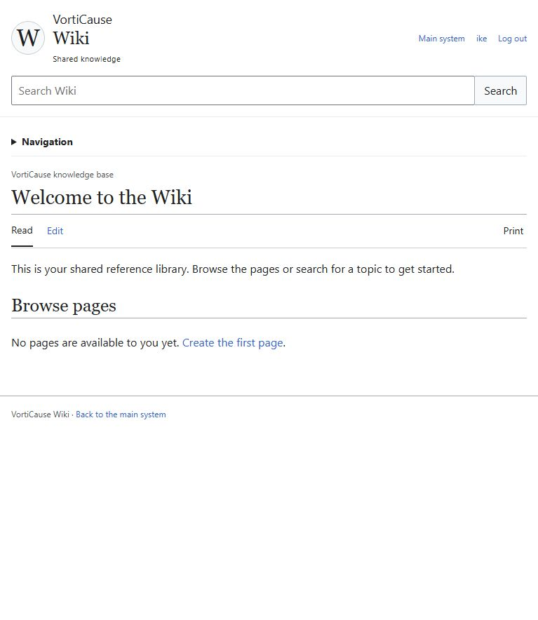
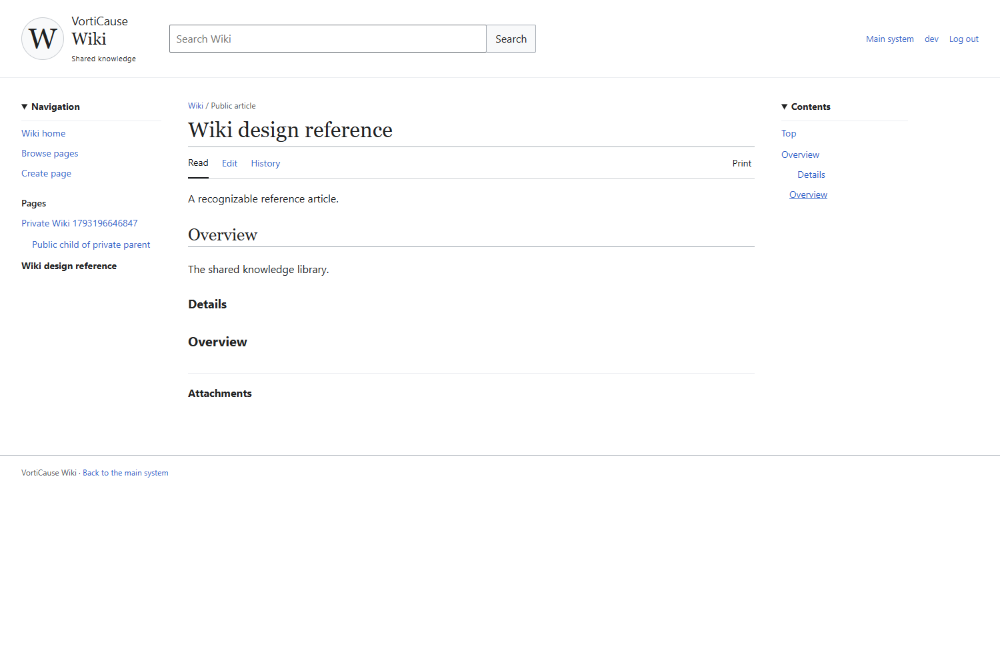
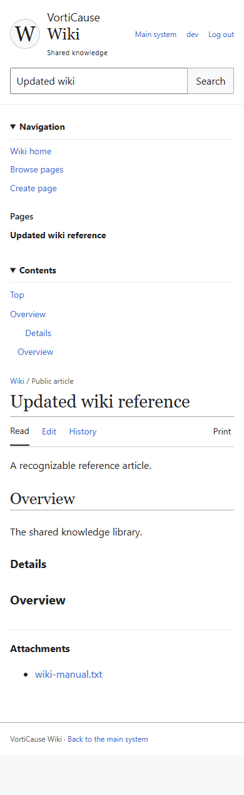

# Wiki redesign release — October 28, 2026

The Wiki redesign is deployed and open for testing. It uses the existing Wiki engine and shared system accounts/session. This was a data-preserving, code-only corrective release. The explicitly approved focused Wiki validation passed; broader platform acceptance remains outstanding.

## Deployed identity

| Item | Value |
|---|---|
| Wiki | https://vorti-blog.ike-j-rebout.workers.dev/wiki |
| Deployed application commit | 64f639479f653c9b5f13ee35af93ef70de669856 |
| Artifact SHA-256 | ade8e872f83e9f3399b778ef3b32b4f20316927beee940fd799a7b897bf22b47 |
| Deployment | a44817bc-9c20-4839-8aa1-e7b1e9c8e314 |
| Worker version | a15ade78-0a5c-4164-9046-550caa15c3c6 — 100% of traffic |
| Deployment time | 2026-10-28T14:17:31.757037Z |
| Migration ledger | 63; latest 20261028_000000_unified_publishing |
| New migrations applied | None |
| Live foreign-key violations | 0 |
| Release lease | 207793f4-d053-40cf-9f35-fb3ffc57bfca; observing, revision 10 |

The immediately preceding compatible recovery baseline is deployment 1b4a0293-efca-4f9c-8652-7168a806511a, Worker 1cab544b-630e-4929-afda-e9bbeb5dc405, with the same application database and storage. The pre-audience Worker must not be restored against the current shared-content schema.

## Delivered behavior

- Article-focused Wiki layout, shared-account header/search, authorized hierarchy, Read/Edit/History links, and permission-aware welcome/empty states.
- Server-loaded initial articles, URL-addressable views, legacy manage=1 links and same-origin Wiki returns through the existing system login. No separate accounts or login screen were introduced.
- Stored heading rendering, deterministic duplicate-safe contents anchors, responsive disclosures, keyboard focus/skip navigation and print styling.
- Existing rich-text editing, revisions, protected attachments, conflict drafts and unsaved-change protection. Save feedback remains visible after hierarchy refresh.
- Styles isolated to the Wiki; existing Intranet, administration, invitation and login interfaces retained. No discussion, watchlist, comparison or recent-changes placeholders.

## Focused validation

All results below target application commit 64f639479f653c9b5f13ee35af93ef70de669856 and the exact artifact above, in Node 22.23.2 with locked dependencies in the pinned Linux release image.

| Gate | Result |
|---|---|
| TypeScript | Passed |
| Error-only lint | Passed |
| Focused repository/recovery/interface/release tests | 28 passed across 9 files, one complete invocation |
| Focused browser acceptance | 3 passed; no failed or skipped scenarios, one complete invocation |
| Production build and packaging | Passed |
| Tracked-source byte fingerprint | Unchanged before/after build, packaging and fixture setup |
| Artifact inventory and secret/fixture/recovery scan | Passed; 147 files |

Browser scenarios cover public/private ancestry, protected downloads and feature gates; article rendering, stored heading levels and duplicate anchors; editor save/reload, publishing, files, retained conflicts, unsaved changes and history; search/mobile disclosures/no horizontal overflow; existing shared login, Wiki return navigation, expired sessions and rejected external redirects. Additional manual checks created a private draft through the real rich-text editor and verified canonical URL/reload persistence in the isolated fixture.

Focused repository checks cover separate readers/history readers/editors, inactive membership and cross-tenant denial, administrator private-read auditing, hierarchy restrictions, disabled features and unchanged Wiki recovery. No full-platform integration/shared-package/browser pass is claimed.

Earlier fixture-type/setup failures and the earlier artifact's failed browser invocation remain recorded in local operational evidence. The browser failure exposed the disappearing save-feedback issue and a test selector that did not match the existing Login button; both were corrected before the final passing run. Build warnings about the existing middleware convention and a generated dependency typeof check remain non-fatal; they were not treated as test passes or suppressed.

## Cutover and live verification

Production source, deployment, bindings, ledger and foreign keys were rechecked immediately before cutover. Queue delivery was paused without purging messages, maintenance activated, jobs drained and writes guarded. A fresh stopped-write export was restored in isolation and passed integrity/foreign-key checks. The code-only path verified the exact registered chain without invoking migrations, installation, content conversion or portal seeding. The immutable package was uploaded without rebuilding, using the existing URL, secrets and bindings.

After deployment, 2000 original records across 44 populated tables matched recovery evidence, including content, settings and credentials. Only ephemeral sessions/document locks and login housekeeping fields were excluded from comparison. Maintenance returned 503/private,no-store during protected verification; the retained administrator session was verified through /api/users/me before reopening. Access reopened and preserved queue delivery resumed.

Live Wiki and shared-login pages return 200; anonymous draft requests and unavailable/private identifiers return 404; unauthenticated Edit redirects to the shared login. Wiki/API responses remain private and non-cacheable. The signed-in Wiki shows the existing ike account and the private-default editor loads. The current live Wiki has no existing articles; substantive article/private/history/file/mutation scenarios were therefore exercised in isolated fixtures. No production test article was saved.

## Recovery inventory and remaining acceptance

Temporary preliminary and stopped-write SQL exports/restored SQLite copies remain under .wrangler/wiki-release/ with integrity/hash receipts; their contents and credentials are excluded from Git. The prior release's recovery material remains retained separately. Six Wiki build/preview containers were stopped; their isolated volumes/artifacts remain retained pending broader acceptance. No production database, storage bucket, queue or unrelated resource was deleted.

This corrective release does **not** complete the earlier platform acceptance or its cleanup. The lease remains observing; no 600-second correlated health window is claimed. Outstanding work is preserved in [the prior release receipt](unified-publishing-release-20261028.md), including:

1. Main template name/purpose/default selection and final menu-correction regression.
2. Complete final-source platform integration/shared-package validation, including the unchanged-budget time-tracking case if it recurs, and the full platform browser suite.
3. Unified publishing functional/security, cross-product and populated upgrade/recovery acceptance.
4. At least 600 continuous seconds of attached, correlated production telemetry/probes with no failures, gaps, server errors or exceptions.
5. Acceptance-dependent recovery/fixture cleanup, final acceptance closure and transition to complete only after those gates actually pass.

The release tooling's source-bound focused-validation exception records these outstanding gates. It does not relabel omitted platform suites as passed. See [machine-readable release evidence](wiki-release-20261028/receipt.json) for source/configuration/migration/artifact hashes and recovery inventory.

## Screenshots

Live signed-in Wiki welcome page (in-app browser viewport):

Representative article from the final package's synthetic fixture, desktop:

The same fixture on mobile, with navigation and contents expanded:

This receipt is committed separately after the deployed application commit. The later documentation-only commit does not require a rebuild or another deployment.
